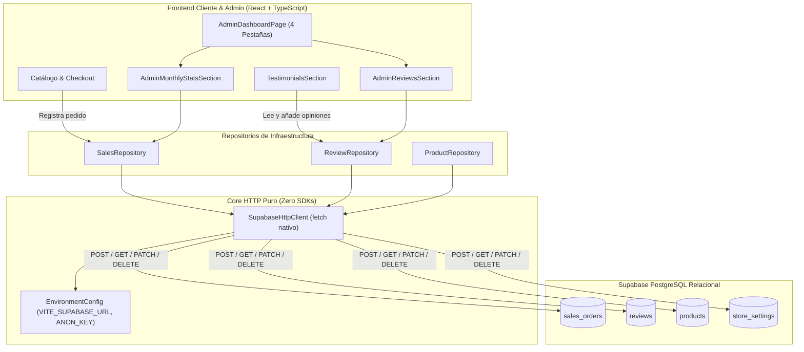

# Documento 1: Arquitectura del Sistema Fullstack (Supabase PostgREST & Cloudflare Edge)

## Resumen Ejecutivo

Este documento define la arquitectura técnica y los patrones de diseño para la plataforma **Cuentas Stream Multiplataforma** con persistencia distribuida y relacional en **Supabase (PostgreSQL 15+)** y compatibilidad con **Cloudflare D1 / Local Storage**.

El sistema está estructurado bajo **Clean Architecture**, **Domain-Driven Design (DDD)**, **Vertical Slicing (Feature-Sliced Design)** y la **Regla de Gobernanza de Cero SDKs Comerciales**, interactuando con la base de datos a través de peticiones HTTP nativas REST/PostgREST.

---

## 1. Mapeo de Capas de la Solución

```
┌────────────────────────────────────────────────────────────────────────┐
│  CAPA DE PRESENTACIÓN (UI / React 18 + Tailwind CSS)                   │
│  - Catálogo, Carrito de Compras, Panel de Control Admin, Testimonios   │
└───────────────────────────────────┬────────────────────────────────────┘
                                    │ Invocación de casos de uso y repositorios
┌───────────────────────────────────▼────────────────────────────────────┐
│  CAPA DE APLICACIÓN Y DOMINIO (src/modules/*/{domain,application})    │
│  - Entidades puras: SaleOrder, Review, Product, AdminConfig            │
│  - Validaciones de negocio, cálculo de métricas financieras del mes    │
└───────────────────────────────────┬────────────────────────────────────┘
                                    │ Consumo de clientes HTTP nativos
┌───────────────────────────────────▼────────────────────────────────────┐
│  CAPA DE INFRAESTRUCTURA (src/core/http/ & src/modules/*/infra)        │
│  - SupabaseHttpClient (fetch nativo, sin dependencias @supabase/sdk)   │
│  - PostgREST REST API (/rest/v1/{sales_orders, reviews, products})     │
│  - Estrategia de degradación suave y caché de respaldo LocalStorage   │
└───────────────────────────────────┬────────────────────────────────────┘
                                    │ TLS / HTTPS nativo
┌───────────────────────────────────▼────────────────────────────────────┐
│  BASE DE DATOS RELACIONAL (Supabase / PostgreSQL 15 Engine)            │
│  - Tablas: `products`, `sales_orders`, `reviews`, `store_settings`    │
└────────────────────────────────────────────────────────────────────────┘
```

---

## 2. Diagrama de Componentes del Sistema (Mermaid)



---

## 3. Registro de Decisiones de Arquitectura (ADR)

### ADR-001: Implementación de Supabase mediante PostgREST Nativo (Sin SDK)
- **Contexto:** La regla de gobernanza 4.2 prohíbe terminantemente la instalación de SDKs comerciales empaquetados (`@supabase/supabase-js`, `firebase`, `stripe`).
- **Decisión:** Implementar un cliente HTTP nativo basado en la API Fetch del estándar web (`src/core/http/supabaseHttpClient.ts`). Este cliente interactúa con la interfaz PostgREST de Supabase enviando encabezados `apikey`, `Authorization: Bearer <anon_key>` y `Prefer: return=representation`.
- **Consecuencias Positivas:**
  1. Cero dependencias externas adicionales en `package.json`.
  2. Reducción drástica del tamaño del bundle JavaScript.
  3. Total interoperabilidad con navegadores modernos y Cloudflare Pages.
  4. Resiliencia automática: si no hay credenciales de Supabase configuradas, el cliente activa inmediatamente una capa de respaldo basada en `localStorage` sin interrumpir la experiencia del usuario.

### ADR-002: Modularización Estricta del Panel de Administración
- **Contexto:** La regla de gobernanza exige que ningún archivo supere las 100 líneas de código fuente.
- **Decisión:** Descomponer el panel administrativo en subcomponentes atómicos con pestañas dedicadas:
  1. `AdminDashboardPage.tsx`: Enrutador de pestañas y contenedor principal (<100 líneas).
  2. `AdminMonthlyStatsSection.tsx`: Métricas financieras y KPIs mensuales (<80 líneas).
  3. `AdminOrdersTable.tsx`: Tabla de pedidos recientes y conciliación (<50 líneas).
  4. `AdminReviewsSection.tsx`: Gestor de reseñas y aprobación (<95 líneas).
  5. `AdminReviewCard.tsx`: Tarjeta interactiva de testimonio (<35 líneas).
  6. `AdminStoreConfigSection.tsx`: Formulario de configuración de cuentas bancarias.
