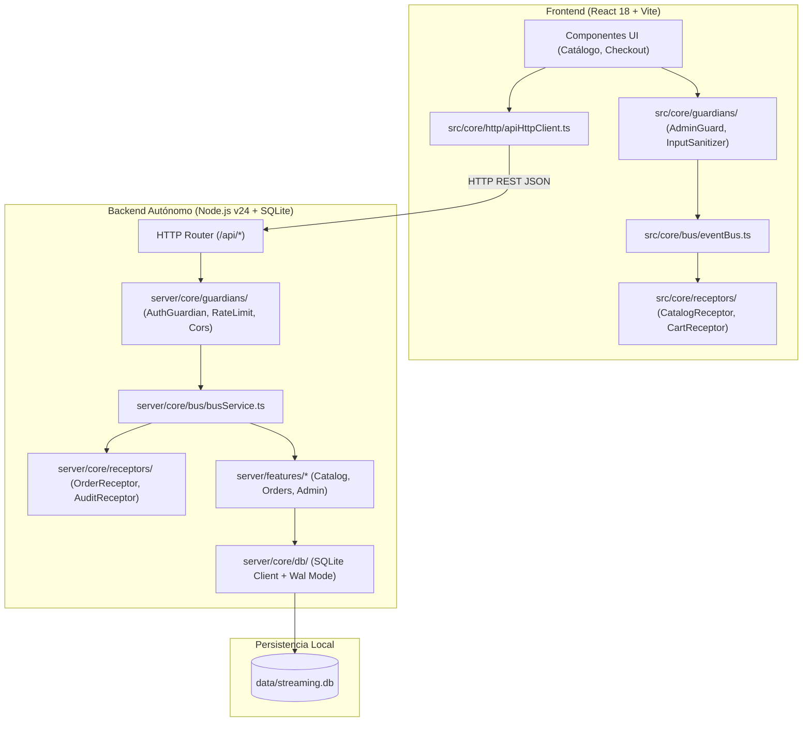

# Propuesta Técnica Integrada: Backend Desacoplado con SQLite Nativo, Bus Service, Guardianes, Receptores, Seguridad de Tokens y SEO Robusto

**Versión:** 2.0.0  
**Fecha:** 2026-10-20  
**Estado:** PROPUESTA CONSOLIDADA CON FEEDBACK DEL USUARIO  
**Gobernanza:** Regla de Oro < 150 líneas por archivo • Cero SDKs comerciales opacos • SOLID / LID  

---

## 1. Alcance y Nuevos Requerimientos Integrados

A partir de la retroalimentación del usuario, la solución incorpora formalmente:
1. **Arquitectura de Guardianes (`guardians/`):** Capa de control, validación, autorización y blindaje tanto en frontend como en backend.
2. **Arquitectura de Receptores (`receptors/`):** Módulos oyentes desacoplados suscritos al `BusService` para reaccionar a eventos de negocio y sincronizaciones.
3. **Seguridad y Tokens Criptográficos:** Emisión, validación y expiración de Bearer Tokens basados en HMAC-SHA256 con protección contra timing-attacks y almacenamiento seguro.
4. **SEO de Alto Nivel:** Etiquetas semánticas, metadatos OpenGraph, Twitter Cards y microdatos Schema.org (JSON-LD) para posicionamiento orgánico en Google.
5. **Reducción Radical de Clics (UX Ultra-Ágil):** Compra directa en 1 clic y persistencia inteligente de perfil de cliente sin modales bloqueantes repetitivos.

---

## 2. Diagrama de Arquitectura con Guardianes y Receptores



---

## 3. Especificación de Componentes

### 3.1. Guardianes (`guardians/`)
- **Backend (`server/core/guardians/`):**
  - `authGuardian.ts`: Valida encabezados `Authorization: Bearer <token>`, expiración y firma criptográfica para endpoints administrativos.
  - `corsGuardian.ts`: Aplica cabeceras de seguridad estrictas (`CORS`, `X-Content-Type-Options: nosniff`, `X-Frame-Options: DENY`).
  - `rateLimitGuardian.ts`: Evita ataques de fuerza bruta y saturación limitando solicitudes por IP.
  - `validationGuardian.ts`: Sanea y valida esquemas de datos entrantes contra inyecciones y payloads malformados.
- **Frontend (`src/core/guardians/`):**
  - `adminRouteGuard.ts`: Verifica vigencia del token local antes de permitir acceso a `#admin`.
  - `checkoutOrderGuard.ts`: Valida que el pedido tenga productos y cantidades válidas antes de iniciar WhatsApp.

### 3.2. Receptores (`receptors/`)
- **Backend (`server/core/receptors/`):**
  - `orderAuditReceptor.ts`: Se suscribe a `ORDER_CREATED` en el bus y registra auditoría con timestamp y métricas.
  - `platformChangeReceptor.ts`: Reacciona a `PLATFORM_MUTATED` para invalidar cachés o emitir alertas de stock.
- **Frontend (`src/core/receptors/`):**
  - `catalogSyncReceptor.ts`: Escucha eventos del bus para actualizar instantáneamente las tarjetas del catálogo sin recargar.
  - `uxNotificationReceptor.ts`: Despacha micro-toasts ágiles y no bloqueantes ante eventos de interacción.

### 3.3. Seguridad y Tokens Criptográficos
- **Motor Criptográfico Nativo:** Uso del módulo `node:crypto` de Node.js v24.
- **Firma de Tokens HMAC:** Tokens de sesión firmados con `crypto.createHmac('sha256', secret)` con carga útil (claim) tipada y tiempo de expiración.
- **Comparación Segura:** `crypto.timingSafeEqual` para verificación de contraseñas de administración, mitigando vulnerabilidades de canal lateral (side-channel attacks).

### 3.4. Estrategia de SEO Robusto
- **`index.html` Optimizado:**
  - `title`: *Cuentas y Pantallas de Streaming Colombia | Entretenimiento Premium*
  - `meta name="description"`: Textos con alta intención comercial (cuentas de Netflix, Disney+, Max, etc.).
  - Protocolo OpenGraph completo (`og:title`, `og:description`, `og:image`, `og:type`, `og:locale`).
  - Twitter Cards (`summary_large_image`).
  - Datos Estructurados JSON-LD (`Schema.org: Store` y `AggregateOffer`) para fragmentos enriquecidos en Google.
- **Estructura Semántica:**
  - Jerarquía estricta `<h1>`, `<h2>`, `<h3>`.
  - Secciones `<section aria-labelledby="...">` y etiquetas accesibles.

---

## 4. Distribución de Archivos y Cumplimiento (< 150 Líneas)

```
server/
├── core/
│   ├── bus/
│   │   ├── busService.ts             # Bus de eventos y comandos (< 95 líneas)
│   │   └── busEvents.ts              # Diccionario de tipos de eventos (< 50 líneas)
│   ├── db/
│   │   ├── sqliteClient.ts           # Conexión nativa node:sqlite en WAL (< 75 líneas)
│   │   └── schemaInitializer.ts      # Inicializador y seed idempotente (< 110 líneas)
│   ├── guardians/
│   │   ├── authGuardian.ts           # Verificación de tokens (< 60 líneas)
│   │   ├── corsGuardian.ts           # Cabeceras seguras (< 45 líneas)
│   │   └── rateLimitGuardian.ts      # Limitador de peticiones (< 60 líneas)
│   ├── receptors/
│   │   ├── orderAuditReceptor.ts     # Oyente de eventos de órdenes (< 60 líneas)
│   │   └── platformChangeReceptor.ts # Oyente de cambios de stock (< 55 líneas)
│   └── security/
│       ├── tokenService.ts           # Creador/Validador HMAC nativo (< 80 líneas)
│       └── passwordHasher.ts         # Hasher con timingSafeEqual (< 60 líneas)
├── features/
│   ├── catalog/                      # Módulo de catálogo (domain, app, infra) (< 120 líneas c/u)
│   ├── orders/                       # Módulo de órdenes (domain, app, infra) (< 110 líneas c/u)
│   ├── admin/                        # Autenticación y configuración (< 115 líneas c/u)
│   └── reviews/                      # Reseñas y testimonios (< 100 líneas c/u)
├── index.ts                          # Entrada del servidor Node en puerto 3001 (< 95 líneas)
└── router.ts                         # Enrutador HTTP REST (< 130 líneas)
```

En el frontend:
- `src/core/guardians/`: `adminGuard.ts`, `checkoutGuard.ts`.
- `src/core/receptors/`: `catalogSyncReceptor.ts`, `uxNotificationReceptor.ts`.
- `src/core/http/apiHttpClient.ts`: Cliente HTTP nativo para consumir la API unificada.
- `index.html`: Metadatos SEO, OpenGraph y JSON-LD.
