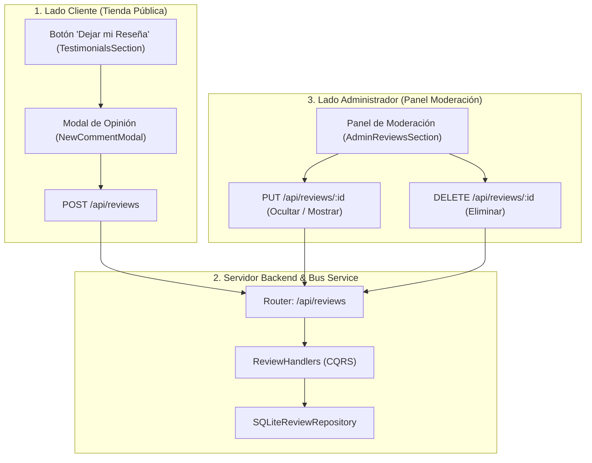

# Propuesta Técnica: Desacoplamiento de Reseñas (Creación en Cliente y Moderación Ocultar/Eliminar en Admin)

**Versión:** 1.0.0  
**Fecha:** 2026-10-20  
**Estado:** PENDIENTE DE REVISIÓN Y APROBACIÓN DEL USUARIO  
**Autor:** Antigravity Engineering Multi-Agent Team (Roles 1 a 5)  
**Gobernanza:** Regla de Oro < 150 líneas por archivo • Clean Architecture • Cero SDKs comerciales  

---

## 1. Resumen Ejecutivo (Agente 1: VP of Engineering)

El usuario especifica una corrección esencial en el flujo de negocio de las opiniones:
1. **Lado del Cliente (Tienda Pública):**
   - Son los **clientes** quienes deben publicar sus opiniones de manera abierta y sencilla desde la tienda pública mediante el modal y botón destacado *"Dejar mi Reseña"*.
2. **Lado del Administrador (Panel de Control):**
   - Se elimina el formulario de creación manual en el panel de administración.
   - El panel de administración se transforma en un **Centro de Moderación** exclusivo donde el administrador puede:
     - **Ocultar / Mostrar:** Alternar la visibilidad de cualquier reseña en tiempo real.
     - **Eliminar:** Borrar definitivamente reseñas fraudulentas o inadecuadas.
     - Visualizar métricas de reseñas (total recibidas, visibles y ocultas).

---

## 2. Arquitectura de la Solución (Agente 2: Staff Architect)



---

## 3. Modelo de Persistencia y Base de Datos (Agente 3: Principal DBA)

### 3.1. Ajuste en Esquema SQLite (`reviews`)
Se asegura que la tabla `reviews` en `backend/core/db/schemaInitializer.ts` cuente con el campo de visibilidad:
```sql
CREATE TABLE IF NOT EXISTS reviews (
  id INTEGER PRIMARY KEY AUTOINCREMENT,
  author_name TEXT NOT NULL,
  city TEXT DEFAULT 'Colombia',
  comment TEXT NOT NULL,
  rating INTEGER NOT NULL CHECK (rating >= 1 AND rating <= 5),
  verified INTEGER DEFAULT 1,
  is_approved INTEGER DEFAULT 1, -- 1 = Visible en tienda, 0 = Oculta por el admin
  created_at TIMESTAMP DEFAULT CURRENT_TIMESTAMP
);
```

### 3.2. Operaciones SQL
- **Listado Público:** `SELECT * FROM reviews WHERE is_approved = 1 ORDER BY created_at DESC`
- **Listado Admin:** `SELECT * FROM reviews ORDER BY created_at DESC` (muestra todas con su badge)
- **Moderar Visibilidad:** `UPDATE reviews SET is_approved = ? WHERE id = ?`
- **Eliminar Reseña:** `DELETE FROM reviews WHERE id = ?`

---

## 4. Plan de Implementación Modular < 150 Líneas (Agente 4 & 5)

| Capa | Archivo | Responsabilidad (< 150 líneas) |
| :--- | :--- | :--- |
| **Backend DB** | `backend/features/reviews/infrastructure/sqliteReviewRepository.ts` | CRUD completo en SQLite: `getAll`, `create`, `toggleVisibility`, `delete`. |
| **Backend CQRS** | `backend/features/reviews/application/reviewHandlers.ts` | Handlers para comandos `CREATE_REVIEW`, `TOGGLE_REVIEW_VISIBILITY`, `DELETE_REVIEW`. |
| **Backend Router** | `backend/router.ts` | Rutas `GET /api/reviews`, `POST /api/reviews`, `PUT /api/reviews/:id`, `DELETE /api/reviews/:id`. |
| **Frontend Client** | `src/modules/testimonials/presentation/TestimonialsHeader.tsx` | Botón visualmente atractivo y de fácil acceso para clientes. |
| **Frontend Admin** | `src/modules/admin/presentation/AdminReviewsSection.tsx` | Eliminación del formulario de creación; adición de filtros rápidos (Todas, Visibles, Ocultas) y acciones directas. |
| **Frontend Admin** | `src/modules/admin/presentation/AdminReviewCard.tsx` | Tarjeta con botones reactivos de *"Ocultar/Aprobar"* y *"Eliminar definitivamente"*. |

---

## 5. Beneficios de la Mejora
1. **Experiencia de Usuario Auténtica:** Los clientes reales pueden calificar su servicio desde la web.
2. **Control Total del Negocio:** El administrador modera qué testimonios se exponen en la tienda sin necesidad de redactar reseñas ficticias en su panel.
3. **Persistencia Real:** Los cambios de visibilidad y eliminación se guardan de forma permanente en SQLite y no solo en caché local.
