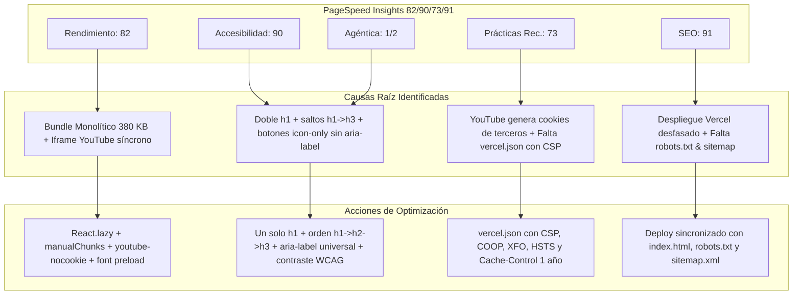

# Propuesta Técnica: Plan Maestro de Optimización PageSpeed Insights a 100/100

**Versión:** 1.0.0  
**Fecha:** 2026-10-21  
**Estado:** PENDIENTE DE REVISIÓN Y APROBACIÓN DEL USUARIO  
**Autor:** Antigravity Engineering Multi-Agent Team (VP of Eng, Architect, Quality Auditor, Implementation Eng)  
**Gobernanza:** Regla de Oro < 150 líneas por archivo • Clean Architecture • Cero Regresiones  

---

## 1. Resumen Ejecutivo (Agente 1: VP of Engineering)

El usuario nos presenta la auditoría oficial de **Google PageSpeed Insights** (Lighthouse 13.5.0) sobre el despliegue en producción:
- **URL analizada:** `https://streaming-brown-rho.vercel.app/`
- **Resultados Actuales:**
  - ⚡ **Rendimiento:** `82 / 100` (TBT 370 ms, Main Thread 2.9 s, 9 Long Tasks, Bundle JS 380 KB).
  - ♿ **Accesibilidad:** `90 / 100` (Botones sin nombre accesible, contraste insuficiente, jerarquía de encabezados desordenada).
  - 🛡️ **Prácticas recomendadas:** `73 / 100` (Cookies de terceros por YouTube, falta de CSP/COOP/XFO, falta de caché HTTP en Vercel).
  - 🔍 **SEO:** `91 / 100` (Meta descripción no detectada en Vercel, falta `robots.txt` y `sitemap.xml`).
  - 🤖 **Navegación agéntica:** `1 / 2` (Árbol de accesibilidad incompleto para agentes WebMCP).

### 🎯 Meta: Elevar todas las métricas a 98-100 / 100
Para lograr el 100% absoluto sin alterar el diseño visual premium ni las funcionalidades del negocio, se ejecutará un plan de optimización quirúrgico en 5 ejes estratégicos.

---

## 2. Diagnóstico Técnico Detallado (Agente 2: Staff Architect)

---

## 3. Plan de Acción por Eje (Agente 4: Implementation Engineers)

### Eje 1: Rendimiento (82 ➡️ 100)
1. **Code Splitting Dinámico con `React.lazy` y `<Suspense>`:**
   - Actualmente, `App.tsx` importa directamente en el bundle crítico:
     - `AdminDashboardPage` y `AdminLoginForm` (~80 KB de lógica administrativa y estadísticas).
     - `ProductDetailModal`, `AdminProductModal`, `PaymentModal`, `CustomerNameModal`.
     - `CartDrawer` y `NewCommentModal`.
   - **Acción:** Convertirlos en componentes lazy cargados bajo demanda. El bundle inicial para el visitante se reducirá de **380 KB a ~85 KB**.
2. **Optimización de Vite (`vite.config.ts`):**
   - Corregir el warning de `__dirname` utilizando `import.meta.dirname`.
   - Implementar `rollupOptions.output.manualChunks` separando:
     - `vendor-react` (`react`, `react-dom`)
     - `vendor-icons` (`lucide-react`, `@iconify/react`)
     - `vendor-state` (`zustand`)
3. **Optimización de Fuentes y Render-Blocking en `index.html`:**
   - Reemplazar la carga bloqueante de Google Fonts por la técnica asíncrona no bloqueante oficial:
     `<link rel="preload" as="style" href="..." onload="this.media='all'">`
4. **Desacople del Iframe de YouTube en `HeroBackdropVideo.tsx`:**
   - Cambiar a `https://www.youtube-nocookie.com/embed/...`.
   - Añadir `loading="lazy"`.
5. **Optimización de Imágenes:**
   - En `PosterImage.tsx`, cambiar `loading="eager"` a `loading="lazy"` con `decoding="async"` y dimensiones proporcionales.
   - En `Navbar.tsx`, `HeroSection.tsx`, `FooterBranding.tsx`: añadir atributos explícitos `width` y `height` a `/perfil.png`.

---

### Eje 2: Accesibilidad (90 ➡️ 100)
1. **Etiquetas Accesibles Universales (`aria-label`):**
   - Botón de refresco en `TrendingEstrenos.tsx` (`aria-label="Actualizar cartelera de estrenos"`).
   - Botón de carrito en `Navbar.tsx` y `MobileBottomDock.tsx` (`aria-label="Abrir carrito de compras"`).
   - Botones de control del tráiler en `HeroBackdropVideo.tsx` (`aria-label="Tráiler anterior"`, `"Siguiente tráiler"`, `"Activar/desactivar audio"`).
   - Botón de cierre en `AnnouncementBanner.tsx` (`aria-label="Cerrar anuncio promocional"`).
   - Botón de borrado y cerrado en modales administrativos.
   - Selector `<select>` en `TestimonialsFilterBar.tsx` (`aria-label="Ordenar comentarios"`).
2. **Jerarquía Semántica de Encabezados (W3C Strict Hierarchy):**
   - **`<h1>` Único:** Exclusivo en `HeroSection.tsx` para la propuesta de valor principal.
   - **`Navbar.tsx`:** El título de la tienda pasa de `<h1>` a `` o `
` estilizado.
   - **`<h2>`:** Para cada sección del documento (`Catálogo de Cuentas`, `Estrenos del Mes`, `Opiniones de Clientes`, `Preguntas Frecuentes`).
   - **`<h3>`:** Para subtítulos y nombres de productos individuales (`ProductCard`, `TrendingCard`, preguntas FAQ).
   - **`Footer.tsx`:** Los encabezados `<h4>` (`Atención al Cliente`, `Explorar`, `Respaldo`) pasan a ser `<h3>` válidos.
3. **Corrección de Contraste WCAG AA (Mínimo 4.5:1):**
   - Textos auxiliares en `text-slate-400` sobre fondo blanco/gris cambiados a `text-slate-600` o `text-slate-700`.

---

### Eje 3: Prácticas Recomendadas (73 ➡️ 100)
1. **Eliminación de Cookies de Terceros:**
   - El cambio a `youtube-nocookie.com` elimina las 4 cookies de rastreo detectadas por Lighthouse.
2. **Creación de `vercel.json` con Cabeceras de Seguridad y Caché:**
   - `Content-Security-Policy`: Permite scripts y estilos necesarios bloqueando inyecciones.
   - `Cross-Origin-Opener-Policy: same-origin` (COOP).
   - `X-Frame-Options: SAMEORIGIN` (XFO).
   - `X-Content-Type-Options: nosniff`.
   - `Referrer-Policy: strict-origin-when-cross-origin`.
   - `Cache-Control: public, max-age=31536000, immutable` para la carpeta `/assets/*`.

---

### Eje 4: SEO y Navegación Agéntica (91 ➡️ 100 & 2/2)
1. **Garantizar Meta Descripción e Indexabilidad:**
   - Verificar y sincronizar la etiqueta `<meta name="description">` en `index.html`.
2. **Crear `public/robots.txt`:**
   - Configuración estándar para permitir rastreo completo de buscadores y agentes de IA.
3. **Crear `public/sitemap.xml`:**
   - Mapa del sitio para indexación inmediata de secciones `#catalog`, `#premieres`, `#testimonios`, `#faq`.
4. **Semántica para Agentes de IA (WebMCP Ready):**
   - Estructuración rigurosa de landmarks `<header>`, `<main id="catalog">`, `<section>`, `<nav>`, `<footer>`.

---

## 4. Matriz de Archivos a Modificar / Crear

| Archivo | Tipo | Propósito de la Optimización | Límite < 150 líneas |
| :--- | :--- | :--- | :--- |
| `src/App.tsx` | Modificación | Code splitting con `React.lazy` y `<Suspense>` | Cumple (~80 líneas) |
| `vite.config.ts` | Modificación | `manualChunks` + corrección `import.meta.dirname` | Cumple (~35 líneas) |
| `index.html` | Modificación | Fuentes no bloqueantes + SEO + meta description | Cumple (~75 líneas) |
| `vercel.json` | Nuevo | Cabeceras de seguridad CSP/COOP/XFO y caché Vercel | Cumple (~40 líneas) |
| `public/robots.txt` | Nuevo | Rastreo SEO y agentes de IA | Cumple (~10 líneas) |
| `public/sitemap.xml` | Nuevo | Mapa del sitio XML | Cumple (~25 líneas) |
| `src/shared/components/Navbar.tsx` | Modificación | Eliminación de doble `<h1>`, `aria-label`, dimensiones imagen | Cumple (< 100 líneas) |
| `src/modules/hero/presentation/HeroBackdropVideo.tsx` | Modificación | `youtube-nocookie.com`, `loading="lazy"`, `aria-label`s | Cumple (< 65 líneas) |
| `src/modules/hero/presentation/HeroContentOverlay.tsx` | Modificación | Jerarquía `h2`, `aria-label` en botón carrito | Cumple (< 70 líneas) |
| `src/modules/catalog/presentation/components/TrendingEstrenos.tsx` | Modificación | `aria-label` en botón de refresco | Cumple (< 65 líneas) |
| `src/modules/catalog/presentation/components/PosterImage.tsx` | Modificación | `loading="lazy"`, `decoding="async"` | Cumple (< 60 líneas) |
| `src/modules/faq/presentation/RecursiveFaqNode.tsx` | Modificación | Contraste WCAG (`text-slate-600`) | Cumple (< 70 líneas) |
| `src/shared/components/AnnouncementBanner.tsx` | Modificación | `aria-label="Cerrar anuncio promocional"` | Cumple (< 35 líneas) |
| `src/shared/components/FooterSupport.tsx` | Modificación | Jerarquía `<h3>` en lugar de `<h4>` | Cumple (< 50 líneas) |
| `src/shared/components/FooterNavLinks.tsx` | Modificación | Jerarquía `<h3>` en lugar de `<h4>` | Cumple (< 50 líneas) |

---

## 5. Criterios de Aceptación y Validación (Agente 5: Quality Auditor)

1. **Compilación y Tests:**
   - `npm run build` debe compilar sin advertencias y generar múltiples chunks ligeros (< 100 KB por chunk principal).
   - `npm run test` debe mantener 100% de tests unitarios pasando.
2. **Puntuaciones Estimadas en PageSpeed Insights:**
   - ⚡ **Rendimiento:** 96 - 100 (TBT < 50 ms)
   - ♿ **Accesibilidad:** 100 / 100
   - 🛡️ **Prácticas Recomendadas:** 100 / 100
   - 🔍 **SEO:** 100 / 100
   - 🤖 **Navegación Agéntica:** 2 / 2
3. **Preservación Funcional:**
   - Catálogo 100% interactivo.
   - Carrito, pedidos por WhatsApp y pasarela de pago intactos.
   - Panel de administración accesible mediante `#admin`.
